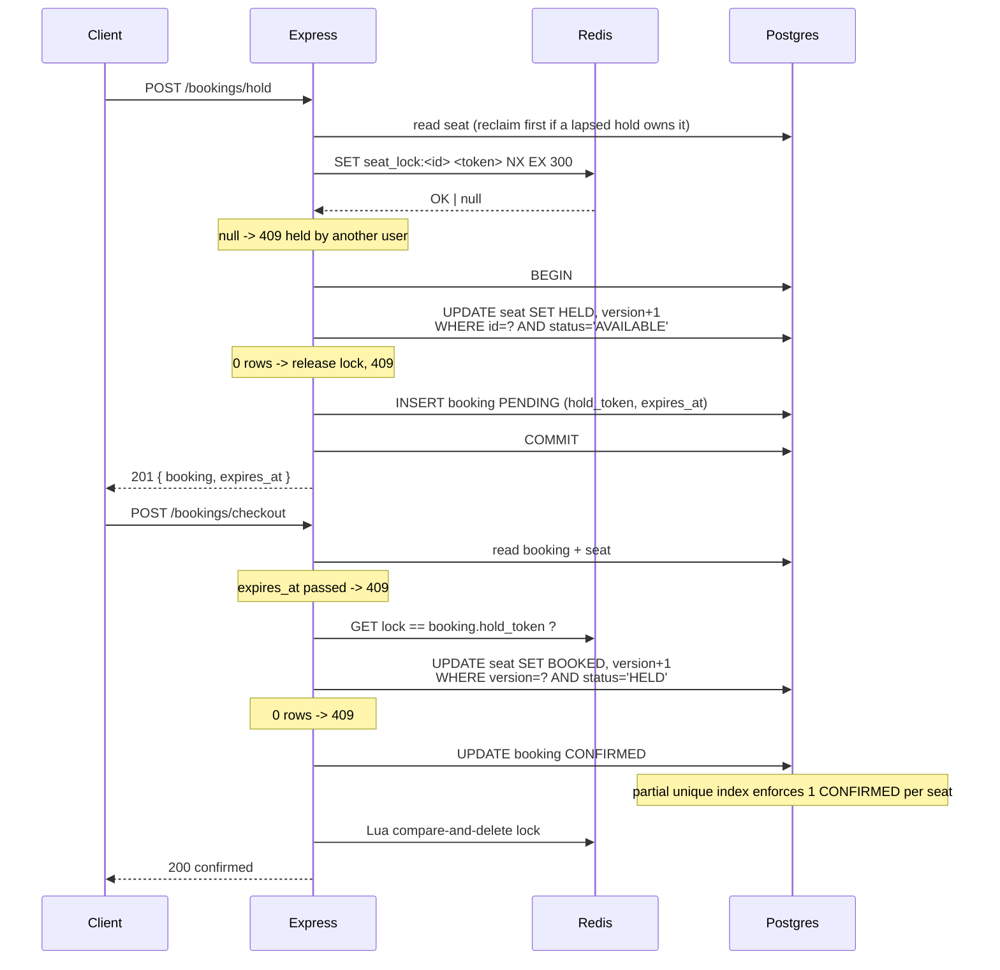

# Concurrent Event Booking API

A seat-booking service that guarantees at most one confirmed booking per seat under concurrent load. Booking is two-phase: a time-bounded hold, then a confirmation.

**Stack:** TypeScript · Express 5 · PostgreSQL (Prisma) · Redis · Vitest · Docker Compose

---

## Booking flow



---

## Concurrency control

Four independent mechanisms, each covered by its own tests.

### 1. Redis advisory lock

`SET NX EX` keyed on the seat, valued with a random per-hold token. The token acts as a fence: a user id would not be unique to a single hold, so a retry could not be distinguished from the original holder.

Release is an atomic Lua compare-and-delete:

```lua
if redis.call("GET", KEYS[1]) == ARGV[1] then
  return redis.call("DEL", KEYS[1])
else
  return 0
end
```

A plain `GET` followed by `DEL` would race: if the TTL lapsed between the two calls and another request acquired the lock, the `DEL` would remove a lock it never owned.

This layer makes contention cheap and rejects losers quickly. It is not the correctness guarantee.

### 2. Guarded conditional write

The claim succeeds only if the seat is `AVAILABLE` at write time:

```ts
const claimed = await tx.seat.updateMany({
  where: { id: seatId, event_id: eventId, status: 'AVAILABLE' },
  data:  { status: 'HELD', version: { increment: 1 } },
});
if (claimed.count === 0) throw new SeatUnavailableError();
```

Predicated on `status`, not on the version read earlier in the request. A version predicate would also reject the benign case where another user held and released the seat in between, leaving it genuinely free.

### 3. Optimistic concurrency control on confirm

Confirmation requires the seat to still be the exact `HELD` row the hold observed:

```ts
where: { id: booking.seat_id, version: currentVersion, status: 'HELD' }
```

Zero rows matched means the request lost a race, and it returns 409.

### 4. Partial unique index

```sql
CREATE UNIQUE INDEX "Booking_one_confirmed_per_seat"
    ON "Booking"("seat_id")
    WHERE "status" = 'CONFIRMED';
```

Enforced by Postgres regardless of application logic. Scoped to `CONFIRMED` only: holds are soft state managed by mechanisms 1–3, and constraining `PENDING` would also stop the baseline endpoints from demonstrating oversell.

Prisma cannot express filtered unique indexes for Postgres, so this is raw SQL inside the migration.

---

## Hold expiry

Expiry is driven by `Booking.expires_at` in the database rather than the Redis TTL, because only the database value survives a Redis restart.

Two entry points share one guarded implementation:

- **Lazy reclaim** runs inline when a request touches a seat whose hold has lapsed.
- **Periodic sweeper** runs on `setInterval` (`REAPER_INTERVAL_MS`) and corrects inventory for seats nobody is currently requesting.

Both refuse to free a seat that is `BOOKED` or that a newer still-valid hold owns. Lapsed holds become `EXPIRED`; user-released holds become `CANCELLED`.

---

## Data model

| Model | Key fields |
|---|---|
| `Event` | `id`, `name`, `total_seats`, `start_time` |
| `Seat` | `id`, `event_id`, `label`, `status` (`AVAILABLE`/`HELD`/`BOOKED`), `version` |
| `Booking` | `id`, `user_id`, `seat_id`, `status` (`PENDING`/`CONFIRMED`/`EXPIRED`/`CANCELLED`), `hold_token`, `expires_at` |

Indexes: `Seat(event_id, status)`, unique `Seat(event_id, label)`, `Booking(seat_id)`, `Booking(status, expires_at)`, plus the partial unique index above. Postgres does not index foreign keys automatically.

---

## Setup

Requires Node 18+, PostgreSQL, and Redis.

```bash
docker compose up -d              # Postgres + Redis
cp .env.example .env              # set your password; URL-encode specials (# -> %23)
npm install
```

Create both databases and apply migrations:

```bash
createdb event_booking
createdb event_booking_test

npx prisma migrate deploy                                       # dev database
DATABASE_URL="<TEST_DATABASE_URL>" npx prisma migrate deploy     # test database

npm run seed
```

`DATABASE_URL` carries `connection_limit=25`. Prisma's default pool would queue concurrent requests inside the client and mask contention during load tests.

Configuration is read from the file named by `ENV_FILE` (default `.env`), which takes precedence over ambient environment variables.

---

## Scripts

| Command | Purpose |
|---|---|
| `npm run dev` | Server with reload; seat map at `http://localhost:3000/` |
| `npm run build` / `npm start` | Compile to `dist/` and run |
| `npm test` | Full Vitest suite |
| `npm run demo` | Baseline vs hardened load test, then hold expiry |
| `npm run loadtest -- --concurrency 200 --mode safe` | Load test a single seat |
| `npm run db:reset` | Delete bookings, free seats, clear seat locks |
| `npm run seed` | Create one event with 100 seats (idempotent) |

---

## API

| Method | Path | Notes |
|---|---|---|
| `GET` | `/health` | |
| `GET` | `/events` | Includes `available_seats` |
| `GET` | `/events/:id/seats` | Seat map |
| `GET` | `/events/:id/stats` | Status counts plus `oversold_seats`, `duplicate_pending_seats` |
| `POST` | `/bookings/hold` | `{ userId, eventId, seatId }` → 201 / 400 / 404 / 409 |
| `POST` | `/bookings/checkout` | `{ bookingId, userId }` → 200 / 400 / 403 / 404 / 409 |
| `POST` | `/bookings/release` | `{ bookingId, userId }` → 200 / 403 / 409 |
| `GET` | `/bookings/:id` | |
| `POST` | `/bookings/hold-naive` | Unsynchronized baseline, for benchmarking only |
| `POST` | `/bookings/checkout-naive` | Unsynchronized baseline, for benchmarking only |

---

## Testing

35 tests across 7 files, run against real Postgres and Redis rather than mocks. Tests execute serially (`fileParallelism: false`) because they share one database, and they target `event_booking_test` plus Redis logical database 1. The reset helper refuses to run unless both targets match the expected test names.

| File | Coverage |
|---|---|
| `races.test.ts` | Concurrent hold contention, hold-versus-confirm interleaving, stale-hold reclaim, expired checkout, ownership enforcement |
| `invariant.test.ts` | Partial unique index and seat-label uniqueness, written directly through Prisma |
| `seat-lock.test.ts` | Lock exclusivity, owner-fenced release, TTL expiry |
| `expiry.test.ts` | Sweeper reclaim, confirmed bookings untouched, newer holds not stranded |
| `naive.test.ts` | Confirms the baseline endpoints oversell, keeping benchmark comparisons valid |
| `lifecycle.test.ts` | Release, booking read, event stats, 404 handling |
| `smoke.test.ts` | Health and read endpoints |

The hold-versus-confirm interleaving is reproduced deterministically with a Prisma `$use` middleware latch that parks one request immediately after its seat read. `vi.spyOn` is unsuitable for this: Prisma delegate methods are lazy getters, and Vitest's restore leaves them `undefined`, breaking the client for later tests.

---

## Benchmarks

`npm run demo` issues 200 simultaneous hold requests for a single seat, using the same server and seat for both paths.

| Metric | Unsynchronized baseline | Hardened path |
|---|---|---|
| Holds accepted | 159 | 1 |
| Holds rejected (409) | 41 | 199 |
| Checkouts confirmed | 1 | 1 |
| Checkout failures | 158 (unique index) | 0 |
| Hold latency p50 / p95 / p99 | — | 208 / 215 / 216 ms |
| Seats with duplicate live holds | 1 | 0 |
| Seats with multiple confirmations | 0 | 0 |

Both paths end with exactly one confirmed booking, because the partial unique index rejects duplicates at the storage layer. The difference is that the baseline accepts 159 holds it cannot honour.

The load test opens one keep-alive connection per virtual user before issuing the storm. Without that warmup, establishing 200 sockets takes longer than the contention window and the requests arrive staggered.

Figures come from a single machine with database, cache, and load generator on localhost. They show relative behaviour between the two paths, not production capacity.

---

## Seat map UI

`http://localhost:3000/` serves a static seat map through `express.static`, with no build step. Each browser tab is assigned its own user id, so two tabs can contend for the same seat. A Safe/Naive toggle switches which endpoints the UI calls, and the stats panel polls duplicate-hold and oversold counters once per second.

---

## Limitations

- **No authentication.** `userId` is supplied in the request body and CORS is unrestricted. Ownership checks are enforced consistently, but identity itself is unverified.
- **Single-node Redis, not a Redlock quorum.** A failover could hand the same lock to two clients. This is survivable because correctness rests on the database-side guarded write and the unique index rather than on the lock.
- **The unsynchronized endpoints ship in the same binary.** Useful for benchmarking, inappropriate for production.
- **The sweeper runs in-process.** Multiple instances would each sweep; writes are guarded, so this is safe but redundant.
- **`prisma migrate dev` cannot regenerate the partial unique index** and may report it as drift on future schema changes.

## License

MIT
